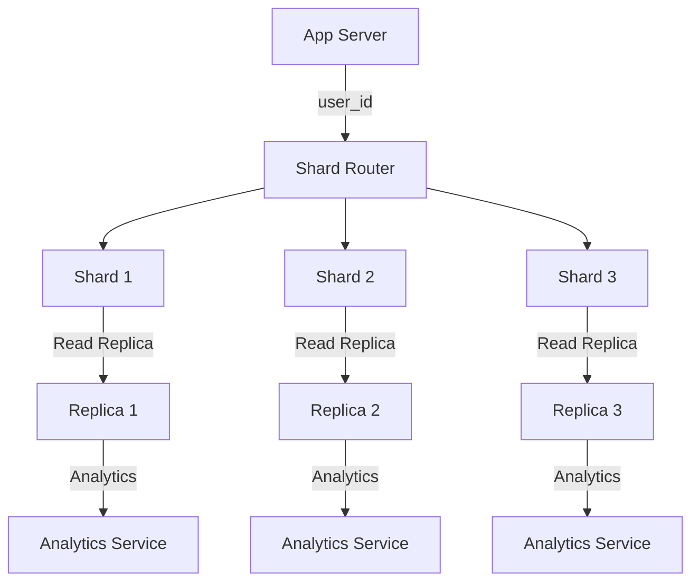

# How to Configure and Provision Database Sharding

> Video Reference: [How to Configure and Provision Database Sharding](https://www.youtube.com/watch?v=98_OJ1Eoibw)

## 1. Asli Problem Kya Hai? (The Core Why)

Swiggy ko socho. Har din 5 lakh orders aate hain, aur har order ke liye ek unique `order_id`, `user_id`, `restaurant_id` store karna padta hai. Agar hum saare data ek single MySQL table mein rakhenge, toh:

- **Latency** badhega because queries scan millions of rows.
- **Throughput** kam ho jayega due to lock contention and slow queries.
- **Scalability** limit hogi; eventually database size hits 10 TB and sharding becomes mandatory.

Agar sharding na karein, toh ek din peak hour pe 200 ms query latency ho sakta hai, aur customers ko “Order failed” ka error dikh jayega. Business impact: revenue loss, brand trust loss. Sharding is the fix that splits data across multiple nodes, keeping each node small and fast.

## 2. Core Architecture & Mechanisms

### 2.1 Sharding Strategy

| Strategy | Use‑case | Pros | Cons |
|----------|----------|------|------|
| **Horizontal (Range) Sharding** | `user_id % 10` → 10 shards | Simple, even data distribution | Range queries across shards hard |
| **Hash Sharding** | `hash(user_id)` | Uniform distribution | Requires lookup on all shards for range queries |
| **Directory/Meta‑sharding** | A lookup table maps key → shard | Flexible, can re‑balance easily | Extra indirection cost |

### 2.2 Partitioning Keys

- **User‑centric**: `user_id` → all user’s orders in same shard. Good for user profile ops.
- **Geographic**: `city_id` → all orders in same city. Good for regional analytics.

### 2.3 Data Placement

- **Primary Shard**: All write ops go here.
- **Read Replicas**: Each shard can have replicas for read scaling. Paytm uses this for its payment gateway.

### 2.4 Consistency Model

- **Strong Consistency**: Use two‑phase commit across shards (slow).
- **Eventual Consistency**: Accept slight lag for write performance (common in e‑commerce).

### 2.5 Load Balancer

- A **shard router** sits between app and database. It reads the sharding key, looks up the shard, and forwards query. Think of it like a *Zerodha* order router directing orders to the right exchange.

### 2.6 Re‑balancing & Hot‑spots

- **Gossip Protocol**: Nodes inform each other about load. Used in Cassandra.
- **Re‑sharding**: Periodically split a hot shard into two, updating the router.

## 3. Architecture Flow

## 4. Production Case Study

**Zomato**:  
During a big festival season, Zomato had to handle 1.2 million orders per hour. They implemented **hash sharding** on `restaurant_id`. Each shard handled ~10k restaurants. They used a **shard router** built on top of Redis for fast key‑to‑shard mapping. Read replicas were spun up using **read‑only replicas** in AWS RDS. For hot restaurants, they introduced **local caching** (Redis) to reduce DB load. Result: average latency dropped from 350 ms to 75 ms, and throughput increased by 4×.

## 5. Trade‑offs (Pros vs Cons)

| Pros | Cons |
|------|------|
| Scales horizontally – add more shards instead of beefier hardware. | Increased complexity in routing logic. |
| Improved query latency due to smaller table sizes. | Cross‑shard joins become expensive or impossible. |
| Better fault isolation – failure of one shard doesn’t bring down the whole system. | Requires careful sharding key selection to avoid hotspots. |
| Easier data migration – can move one shard at a time. | Re‑balancing can be disruptive if not planned. |
| Read scaling via replicas on each shard. | Consistency can suffer if using eventual model. |

## 6. System Design Interview Cheat Sheet

- **Identify sharding key**: User‑centric or geographic based on query patterns.
- **Choose sharding strategy**: Range for predictable growth, hash for uniformity.
- **Implement a shard router**: Keeps app logic simple and centralizes mapping.
- **Plan for read replicas**: Scale reads without affecting writes.
- **Handle re‑balancing**: Use incremental splits, not full migrations.
- **Monitor hotspots**: Use metrics and alerts to trigger re‑sharding early.

---
