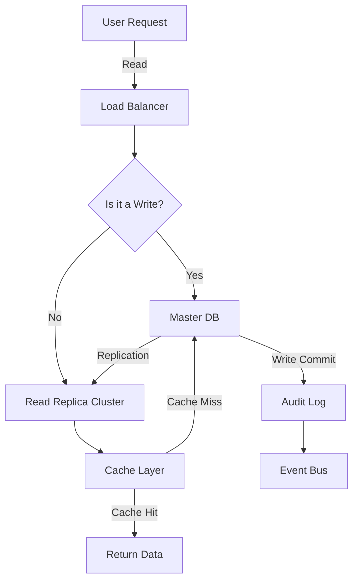

# Database Scaling Basics Explained

> Video Reference: [Database Scaling Basics Explained](https://www.youtube.com/watch?v=CXOZd2OkGGA)

## 1. Asli Problem Kya Hai? (The Core Why)

Swiggy ka order system socho. Har din millions of orders aate hain, aur har order ko realtime mein confirm karna hota hai. Agar database ek single server pe run kare, to latency badh jayegi, queries slow ho jayengi, aur user experience degrade ho jayega. Agar hum isko ignore karein, to traffic spikes (jaise New Year promotion ya festival season) ke dauran system crash ho sakta hai, users ko “Service Unavailable” ka error dikh sakta hai. Isse not only customer churn hota hai, balki brand reputation bhi damage ho jati hai. Yeh problem exist karti hai because a single DB instance cannot handle the massive read/write load aur ensure high availability simultaneously.

## 2. Core Architecture & Mechanisms

### a. Read Replicas
Ek master database writes handle karta hai, aur multiple read replicas read traffic ko distribute karte hain. Lagging replication lag ko “read lag” kehte hain, jo ki consistency ko affect karta hai. Swiggy’s menu lookup ke liye read replicas use kiye jaate hain, taki master overload na ho.

### b. Sharding (Horizontal Partitioning)
Data ko logical partitions (shards) mein divide kiya jata hai, usually user ID ya order ID range ke basis pe. Har shard ek alag database instance ya cluster hota hai. Isse per shard load kam hota hai, aur parallelism badhta hai. Example: IRCTC ke booking system mein seat availability per train per station shard ki ja sakti hai.

### c. Caching Layers
In-memory stores (Redis, Memcached) ko read-heavy queries ke liye use kiya jata hai. Cache miss se database hit hota hai, but cache hit se latency 10x kam ho sakti hai. Paytm’s transaction status checks commonly cache se serve kiye jaate hain.

### d. Load Balancing & Connection Pooling
Database connections ko ek load balancer ke through distribute kiya jata hai, aur connection pooling se resources efficiently reuse hote hain. Ola’s driver app uses a connection pool to avoid opening a new DB connection for each ride request.

### e. Consistency Models
Strong consistency vs eventual consistency ka trade‑off hota hai. Swiggy might choose eventual consistency for menu updates (quick UI refresh) but strong consistency for payment transactions.

### f. Gossip Protocol (Distributed Systems)
Nodes apne state ko gossip ke through share karte hain to maintain cluster health. Cassandra uses gossip to detect node failures. This helps in auto‑scaling and failover.

## 3. Architecture Flow

## 4. Production Case Study

**Netflix** uses a combination of sharding and read replicas for its catalog service. User data is partitioned by country code, while movie metadata is served from a global read‑replica cluster. They also employ a Redis cache layer for popular titles. During the 2022 global launch of a new series, Netflix handled >1.5 billion concurrent viewers by scaling read replicas horizontally and using auto‑scaling groups in AWS. The result: < 200 ms average latency and 99.99% uptime.

## 5. Trade-offs (Pros vs Cons)

| Pros | Cons |
|------|------|
| *Scalability*: Horizontal scaling allows handling massive traffic. | *Complexity*: Sharding logic and cross‑shard joins become hard. |
| *High Availability*: Replicas and failover mechanisms reduce downtime. | *Consistency*: Eventual consistency may lead to stale reads. |
| *Performance*: Caching reduces read latency dramatically. | *Cost*: Multiple replicas and caching layers increase infrastructure spend. |
| *Fault Isolation*: Node failures don’t bring down the whole system. | *Maintenance*: Need for monitoring, rebalance, and data migration tools. |
| *Elasticity*: Auto‑scale clusters based on load patterns. | *Data Integrity*: Need for strong transactional guarantees in distributed writes. |

## 6. System Design Interview Cheat Sheet

- **Identify traffic pattern**: read‑heavy, write‑heavy, or balanced.
- **Choose scaling strategy**: read replicas for reads, sharding for writes.
- **Add caching**: Redis/Memcached for hot data, keep TTL sensible.
- **Plan consistency**: decide on eventual vs strong based on business criticality.
- **Monitor & auto‑scale**: use metrics (latency, error rate) to trigger scaling events.
