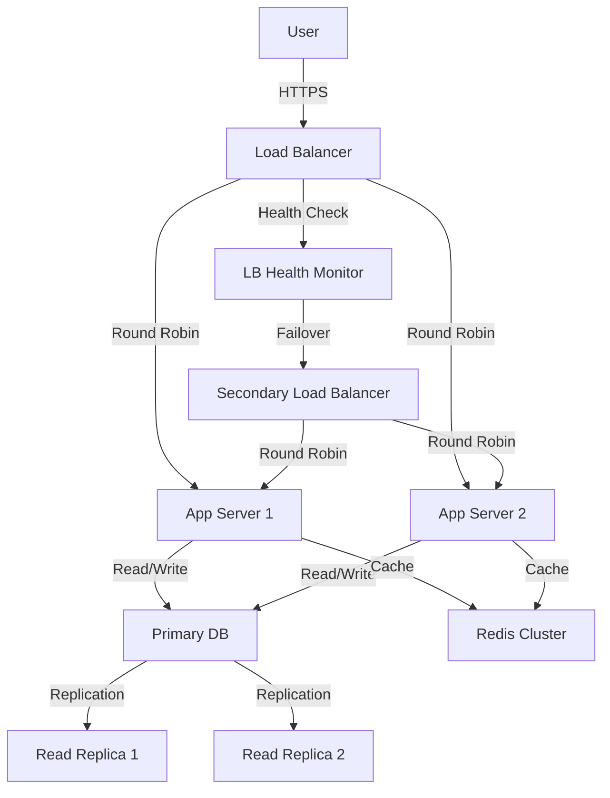

# Single Point of Failure (SPOF) in System Design

> Video Reference: [Single Point of Failure (SPOF) in System Design](https://www.youtube.com/watch?v=Iy2YqgjXtRM)

## 1. Asli Problem Kya Hai? (The Core Why)

Soch lo ek badi traffic wali app – jaise **Swiggy**. Jab user app open karta hai, order place karta hai, delivery track karta hai – sab kuch ek backend stack pe depend karta hai. Agar koi component – jaise ek single database instance, ek single load balancer, ya ek single message broker – crash ho jata hai, toh poora system down ho jata hai. Yehi hota hai **Single Point of Failure**.

- **Impact**: Order process ruk jaata hai, users ko error milta hai, revenue loss hota hai.
- **Why exist**: Shuru mein simplicity aur cost ki wajah se, ek hi instance se kaafi hota hai. Lekin traffic badhne se, redundancy ki zaroorat hoti hai.

## 2. Core Architecture & Mechanisms

### 1️⃣ Redundancy
- **Multiple instances** of same service (stateless) run behind a **Load Balancer**.
- **Active‑Active** ya **Active‑Standby** configuration.

### 2️⃣ Replication
- **Database Replication**: Master‑Slave, Multi‑Master, or **Read Replicas**.
- **Cache Replication**: Redis Sentinel, Cluster mode.

### 3️⃣ Failover & Health Checks
- **Health checks** (HTTP, TCP) by Load Balancer or orchestrator (K8s liveness probes).
- **Automatic failover**: When primary fails, secondary takes over.

### 4️⃣ Distributed Consensus
- **Gossip Protocol** or **Raft** to keep nodes in sync.
- Helps in **Consistency** without single coordinator.

### 5️⃣ Circuit Breaker
- Detects failed calls, short‑circuits to prevent cascading failures.

### 6️⃣ Load Balancing Algorithms
- **Round Robin**, **Least Connections**, **IP Hash** – to spread traffic evenly.

> **Intuition**: Think of a traffic signal (load balancer) directing cars (requests) to multiple lanes (service instances). If the signal stops working, all cars get stuck – that’s SPOF. By having multiple signals (redundant LB), traffic keeps flowing even if one fails.

## 3. Architecture Flow

- **Primary DB** is the single source of truth; **Read Replicas** handle heavy read traffic.
- **Load Balancer** has a secondary instance for failover.
- **Redis Cluster** ensures cache redundancy.

## 4. Production Case Study

**WhatsApp** uses a **distributed architecture** with multiple data centers across the globe. Each data center hosts:
- Multiple **Mnesia** nodes (Erlang’s distributed DB) – no single master.
- **Nginx** load balancers with **Keepalived** for high availability.
- **Gossip** protocol for node discovery.

When one node or data center goes down, traffic is automatically rerouted to others, ensuring **99.999% uptime**. They also use **sharding** to split data, so no single shard becomes a SPOF.

## 5. Trade-offs (Pros vs Cons)

| Pros | Cons |
|------|------|
| Higher availability and fault tolerance | Increased operational complexity |
| Better scalability (horizontal scaling) | Higher cost (more instances, networking) |
| Reduced single point downtime | More sophisticated monitoring & health checks |
| Easier to handle traffic spikes | Potential consistency challenges (CAP trade‑offs) |
| Better user experience | More code paths for failover logic |

## 6. System Design Interview Cheat Sheet

- **Identify potential SPOFs**: DB, cache, LB, single service instance.
- **Use redundancy**: stateless services behind LB, replicated DBs.
- **Implement health checks & auto‑failover**: keep traffic alive when a node dies.
- **Choose right consistency model**: CAP theorem trade‑offs.
- **Test failover scenarios**: simulate node failures, ensure graceful degradation.

---
