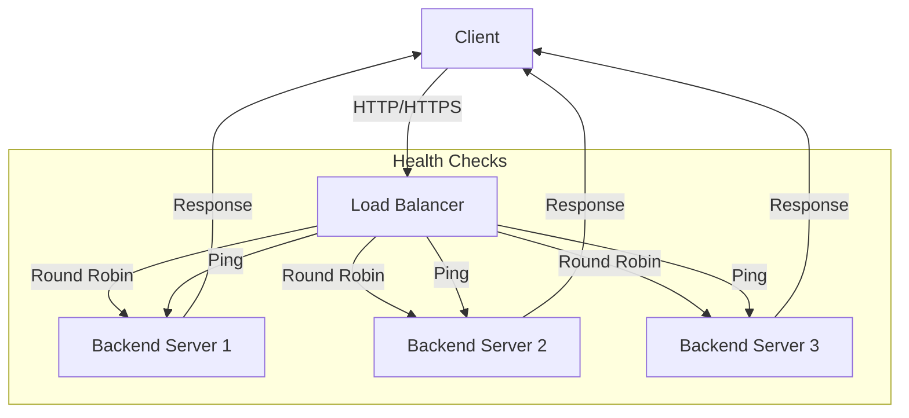

# Load Balancers Explained in 7 Minutes

> Video Reference: [Load Balancers Explained in 7 Minutes](https://www.youtube.com/watch?v=sXUh9vuOTXk)

## 1. Asli Problem Kya Hai? (The Core Why)

Imagine Swiggy ke ek din ka peak time jab 10,000 orders ek sath aa rahe ho.  
Har ek order ka request ek single server pe direct jata, toh kya hoga?

- **Latency spikes** – server overload hone se response time 5‑10x badh jayega.  
- **Throughput drop** – ek server pe request limit cross karne se new requests drop ho jayenge.  
- **Single point of failure** – agar woh server down ho gaya, poora system offline.  

Yahi problem hai jo load balancer solve karta hai: traffic ko multiple healthy servers pe evenly distribute karke high availability aur low latency ensure karta hai.

## 2. Core Architecture & Mechanisms

Load Balancer ek middleware hai jo client requests ko backend servers ki taraf forward karta hai. Main mechanisms:

### 2.1 Routing Algorithms

- **Round Robin** – requests sequentially next server ko forward. Simple, evenly spread.  
- **Least Connections** – sabse kam active connections wala server chune, dynamic traffic ke liye best.  
- **IP Hash** – client IP ke hash se same server pe request send, useful for session persistence.  

### 2.2 Health Checks

LB continuously backend servers ka health status ping karta hai (HTTP GET, TCP CONNECT).  
- **Alive** → request forward.  
- **Dead** → request drop or retry till health returns.  

### 2.3 Session Persistence (Sticky Sessions)

When a user logs in on a particular server (e.g., Paytm wallet), uske subsequent requests should hit same server to read session data from memory.  
- **Cookie based** – LB sets a cookie to remember server.  
- **Source IP** – IP hash use.  

### 2.4 TLS Termination

LB decrypts HTTPS traffic, reduces CPU load on backend servers.  
- **End-to-end encryption** still possible by re-encrypting at LB to backend.  

### 2.5 Layer 4 vs Layer 7

- **Layer 4 (Transport)** – only IP/port level routing, high performance, no content inspection.  
- **Layer 7 (Application)** – can route based on URL, headers, cookies (e.g., route `/api/v1/` to microservice A).  

### 2.6 Scaling Load Balancer

- **Horizontal scaling** – multiple LB instances behind a DNS round‑robin or a higher‑level LB.  
- **Global Traffic Manager** – route users to nearest region (AWS Global Accelerator).  

## 3. Architecture Flow

## 4. Production Case Study

**Uber – Mobile Backend**  
Uber ke mobile app ka traffic 50M+ daily requests tak ja sakta hai.  
- **Architecture**: AWS Application Load Balancer (ALB) in front of a fleet of EC2 instances (each running a microservice).  
- **Routing**: ALB uses **Path‑based routing** – `/rides` → Ride Service, `/payments` → Payment Service.  
- **Health Checks**: Custom health endpoint `/health` with 200 OK.  
- **TLS Termination**: ALB handles SSL, passes plain HTTP to backend.  
- **Auto‑Scaling**: EC2 Auto Scaling groups linked to ALB, so new instances are automatically registered once healthy.  

Result: 99.99% availability, automatic failover, and smooth scaling during surge (e.g., peak Delhi traffic during festivals).

## 5. Trade‑offs (Pros vs Cons)

| Pros | Cons |
|------|------|
| **High availability** – automatic failover to healthy nodes. | **Single point of failure** if LB itself crashes (mitigated by HA). |
| **Scalable** – can add more backend nodes without changing clients. | **Cost** – commercial LB services (AWS ALB, GCP LB) charge per GB and per hour. |
| **Improved performance** – load is spread, reducing latency spikes. | **Complexity** – managing session persistence, health checks, routing rules. |
| **Security** – TLS termination, DDoS mitigation (e.g., AWS Shield). | **Potential bottleneck** if LB hardware or config not optimized. |
| **Observability** – built‑in metrics, logs, alerts. | **Vendor lock‑in** when using proprietary LB solutions. |

## 6. System Design Interview Cheat Sheet

- **Choose LB type** based on traffic pattern: Round Robin for even load, Least Connections for bursty traffic.  
- **Implement health checks** to avoid routing to dead nodes; use custom endpoints.  
- **Decide on session persistence** only when required (e.g., user auth); otherwise keep stateless.  
- **Scale LB horizontally** or use a higher‑level global traffic manager for multi‑region.  
- **Leverage Layer 7 routing** for microservices and API gateways; keep Layer 4 for simple proxy needs.
