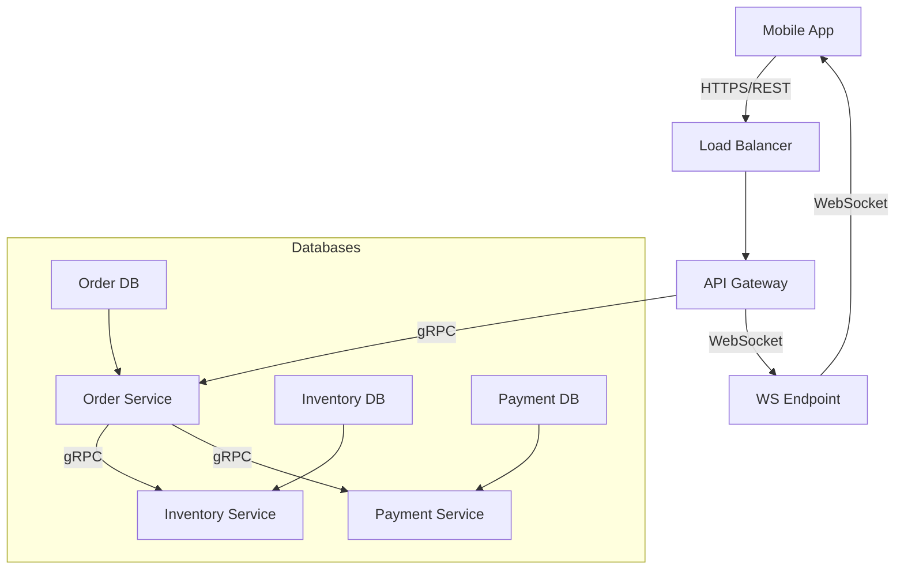

# Ace Your System Design Interview: Essential Application Protocols Explained

> Video Reference: [Ace Your System Design Interview: Essential Application Protocols Explained](https://www.youtube.com/watch?v=Vc-PGeu94c4)

## 1. Asli Problem Kya Hai? (The Core Why)

Maan lo tum Swiggy ka ek new feature design kar rahe ho – **real‑time order tracking**.  
- **High traffic**: 10 lakh orders per day, 50,000 concurrent users.  
- **Low latency**: Users expect < 1 sec update on their order status.  
- **Scalability**: New cities, new restaurants, new payment methods – sab ek saath handle karna hai.  

Agar hum sahi application protocol choose na karein, toh kya ho sakta hai?  
- HTTP/REST ka overhead (header, body, TCP handshake) se **latency** badh jayegi.  
- WebSocket ka misuse se **resource consumption** badh sakta hai – server per open connection.  
- gRPC ke bina **internal microservice communication** slow ho sakti hai, especially for binary data like images.  

Isliye interview mein application protocols pe focus karna zaroori hai – ye decide karte hain ki data kaise travel karega, kitna efficient hoga, aur system ki **availability** aur **throughput** kaise affect hoga.

## 2. Core Architecture & Mechanisms

### HTTP / REST
- **Stateless**: har request mein sab context aata hai.  
- **Simple**: browsers, mobile SDKs, CDN support.  
- **Overhead**: 1‑2 KB headers + TCP handshake (unless HTTP/2).  
- **Use case**: public APIs, CRUD operations, mobile app calls.

### gRPC (Google Remote Procedure Call)
- **Binary protocol (Protocol Buffers)** – compact, fast.  
- **Streaming**: client → server, server → client, bi‑directional.  
- **Service definition** in `.proto` file – clear contract.  
- **Use case**: microservice‑to‑microservice, real‑time chat, telemetry, internal data pipelines.

### WebSocket
- **Full‑duplex** TCP connection.  
- **Low latency** for push notifications.  
- **Connection overhead**: one open per client.  
- **Use case**: order status updates, live chat, gaming.

### GraphQL
- **Single endpoint**; client decides fields.  
- **Reduces over‑fetching** & **under‑fetching**.  
- **Complexity**: resolver logic, caching harder.  
- **Use case**: mobile apps needing flexible data shapes.

### Thrift / Avro (optional)
- **Binary serialization** with language bindings.  
- **Cross‑language** RPC.  
- **Use case**: legacy systems, heterogeneous stacks.

## 3. Architecture Flow

- **Client** hits **HTTPS/REST** for order placement.  
- **API Gateway** routes to **Order Service** via **gRPC** (fast internal call).  
- Order Service updates DBs, triggers **WebSocket** push to client for status.  
- All services communicate via **gRPC** for low latency and strong typing.

## 4. Production Case Study

**Swiggy** (real example)
- Public-facing APIs use **REST** over HTTPS for order creation, menu fetch.  
- Internal microservices use **gRPC** for efficient binary communication – e.g., order matching, kitchen status.  
- For real‑time delivery updates, Swiggy uses **WebSocket** to push ETA changes to the user app.  
- They also use **GraphQL** for their mobile SDK to allow flexible queries on menu items, reducing payload size.

**Uber** (another example)
- Uses **gRPC** for driver‑matching, trip updates, and billing services.  
- WebSocket (or gRPC streaming) for live driver location updates to the rider app.

## 5. Trade-offs (Pros vs Cons)

| Pros | Cons |
|------|------|
| **HTTP/REST**: Simple, stateless, huge ecosystem. | High overhead, no native streaming, can lead to over‑fetching. |
| **gRPC**: Low latency, binary payloads, strong typing, streaming. | Requires code generation, less browser support, steeper learning curve. |
| **WebSocket**: Real‑time, bi‑directional, low round‑trip latency. | One open connection per client → resource intensive, firewall issues. |
| **GraphQL**: Flexible queries, reduces bandwidth, single endpoint. | Resolver complexity, caching harder, query complexity can affect performance. |
| **Thrift/Avro**: Language‑agnostic, efficient serialization. | Less popular than gRPC, maintenance overhead. |

## 6. System Design Interview Cheat Sheet

- **HTTP/REST**: Use for public APIs; keep payload light, leverage caching (ETag, CDN).  
- **gRPC**: Ideal for internal microservices, streaming data, high throughput; remember to version `.proto` files.  
- **WebSocket**: Push notifications, live updates; manage connection pool, use heartbeats.  
- **GraphQL**: When clients need flexible data shapes; plan resolver strategy and caching.  
- **Choose protocol based on**: client type (browser/mobile), data size, latency requirement, and team skill set.
