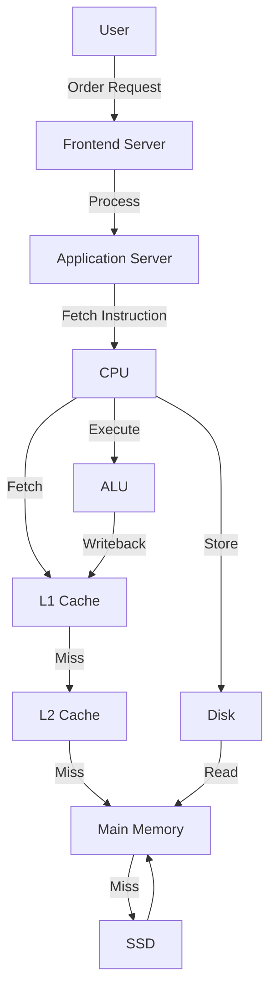

# System Design Concepts: Computer Architecture

> Video Reference: [System Design Concepts: Computer Architecture](https://www.youtube.com/watch?v=um06azpAmSk)

## 1. Asli Problem Kya Hai? (The Core Why)

Maan lo Swiggy ka delivery system har second 10,000 orders process kar raha hai.  
Yeh orders ek ek karke CPU pe jaate hain, CPU ko har ek instruction fetch, decode, execute karna hota hai. Agar CPU architecture inefficient ho—jaise cache miss rate high ho, pipeline stalls ho, ya memory latency badh jaaye—to order processing slow ho jata hai, delivery time badhta hai, aur customer ka experience degrade hota hai.  
Agar hum is problem ko solve na karein, toh Swiggy ko *latency* (delivery delay) aur *throughput* (orders per second) dono mein drop dekhna padega, jisse competitors ko advantage mil jayega.

## 2. Core Architecture & Mechanisms

### CPU
CPU ka main job hai instructions ko execute karna. 3 major components: **ALU** (Arithmetic Logic Unit), **Control Unit**, aur **Registers**. Registers CPU ke andar hi hota hai, isliye fastest memory.

### Memory Hierarchy
1. **Registers** – 10s of nanoseconds.  
2. **Cache (L1, L2, L3)** – 1–10 ns. Small size but super fast.  
3. **Main Memory (RAM)** – 100 ns.  
4. **Secondary Storage (SSD/HDD)** – 1 ms – 10 ms.  
5. **Network** – 10–100 ms.

Hierarchy ka idea: *closest, fastest* first. CPU tries to keep data in cache to avoid slow RAM/SSD hits.

### Cache
Cache ek small, high‑speed memory hota hai jo hot data ko store karta hai. **Cache line** ek fixed size block hota hai.  
- **Cache Coherence**: multiple cores ko same data ke consistent view ki zaroorat hoti hai.  
- **Replacement Policy**: LRU, FIFO, Random.

### Pipelining
CPU instruction execution ko 5 stages mein split karta hai: **IF → ID → EX → MEM → WB**.  
- **Parallelism**: ek instruction ke different stages ek saath chal sakte hain.  
- **Stalls**: data hazards, branch mispredictions se pipeline block ho sakti hai.

### Branch Prediction
Branch instructions (if/else) pipeline ko disturb karte hain. CPU guess karta hai next instruction ka path. Agar guess galat, toh *pipeline flush* hota hai, jisse performance loss hota hai.

### Virtualization & MMU
**Memory Management Unit (MMU)** translates virtual addresses to physical addresses. Virtualization allows multiple OS/processes to share physical memory securely.  

## 3. Architecture Flow

## 4. Production Case Study

**Uber** uses a custom **CPU‑optimized micro‑service** for real‑time trip matching.  
- **Pipelined architecture**: each micro‑service instance processes matching logic in stages, reducing per‑trip latency to ~50 ms.  
- **Cache strategy**: frequently accessed rider‑driver pairings are stored in an in‑memory Redis cache (acts like L1/L2 cache), cutting down database hits.  
- **Branch prediction**: they use a predictive model to pre‑load probable driver locations, avoiding mis‑predictions that would otherwise stall the pipeline.

## 5. Trade-offs (Pros vs Cons)

| Pros | Cons |
|------|------|
| **High throughput** – pipeline allows many instructions per cycle. | **Complex design** – need for hazard detection, branch prediction, cache coherence. |
| **Low latency** – cache keeps hot data close. | **Cache miss penalty** – can be expensive if data not in cache. |
| **Scalability** – multiple cores share memory via MMU. | **Memory bandwidth limits** – can become bottleneck. |
| **Energy efficient** – smaller cache consumes less power. | **Implementation cost** – sophisticated hardware required. |
| **Parallelism** – independent stages execute concurrently. | **Debugging difficulty** – hard to trace pipeline stalls. |

## 6. System Design Interview Cheat Sheet

- **Pipeline stages**: IF → ID → EX → MEM → WB; remember hazards & stalls.  
- **Memory hierarchy**: Registers < L1 < L2 < L3 < RAM < SSD < Network.  
- **Cache coherence**: MESI protocol keeps multi‑core caches consistent.  
- **Branch prediction**: static vs dynamic; misprediction penalty.  
- **Virtualization**: MMU translates virtual to physical; page tables, TLB.
