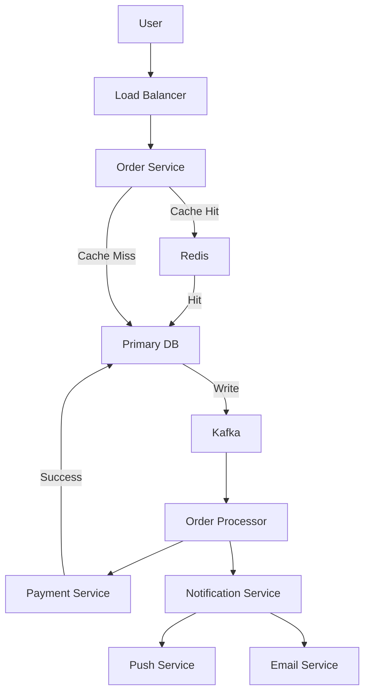

# System Design Concepts: Meeting Design Requirements

> Video Reference: [System Design Concepts: Meeting Design Requirements](https://www.youtube.com/watch?v=YhC7yYDG6i0)

## 1. Asli Problem Kya Hai? (The Core Why)

Maan lo Swiggy ka order placement system hai. Jab user “Order” button dabata hai, system ko 1) **latency** (≤ 200 ms) 2) **throughput** (≥ 10k orders/sec) 3) **consistency** (order not lost) 4) **availability** (always up) 5) **cost-efficiency** ko meet karna hai. Agar yeh requirements poore nahi hue, toh user ko “Order Failed” message milega, revenue loss hoga, aur brand image kharab ho jayega. Yehi problem hai jo “Meeting Design Requirements” ke concept ko define karti hai – har design decision ko business constraints se align karna.

## 2. Core Architecture & Mechanisms

### 2.1 Requirement Analysis
- **Business KPIs**: Order latency < 200 ms, 99.9% uptime.
- **User Expectations**: Immediate confirmation, real‑time tracking.
- **Operational Limits**: Infrastructure cost ₹10 lakh/month.

### 2.2 Design Principles
- **Latency vs Throughput Trade‑off**: Use **Read Replica** for read‑heavy ops, keep primary for writes.
- **Consistency vs Availability**: Choose **CAP** based on use‑case. Swiggy needs *eventual consistency* for menu catalog, *strong consistency* for order placement.
- **Scalability**: **Load Balancer** + **Auto‑Scaling** groups, **Sharding** by region.
- **Fault Tolerance**: **Gossip Protocol** for service discovery, **Circuit Breaker** to avoid cascading failures.

### 2.3 Common Mechanisms
- **Cache Layer**: Redis for hot data (menu items, promo codes).
- **Message Queue**: Kafka for order events, decouple services.
- **Database Partitioning**: Horizontal sharding of orders table by user ID.
- **Health Checks & Monitoring**: Prometheus + Grafana dashboards.

## 3. Architecture Flow

## 4. Production Case Study

**Zomato**:  
Zomato uses a micro‑service architecture with **Kafka** for event streaming. Orders go through a **load‑balanced API gateway** → **Order Service** → **Kafka** → **Payment Service**. They maintain **Read Replicas** for menu data to keep latency < 150 ms. For high availability, they deploy services across **multiple AZs** with **AWS Route 53** health checks. Cost is controlled by using **spot instances** for batch processing.

## 5. Trade-offs (Pros vs Cons)

| Pros | Cons |
|------|------|
| **High Availability** with multi‑AZ deployments and health checks. | **Increased Complexity** – more services, monitoring, and ops overhead. |
| **Scalable Throughput** via sharding & load balancing. | **Higher Latency** on cross‑service calls, especially for consistency‑heavy ops. |
| **Cost Efficiency** with auto‑scaling and spot instances. | **Data Consistency Challenges** when using eventual consistency. |
| **Fault Isolation** through micro‑services and circuit breakers. | **Operational Overhead** – need for robust CI/CD, observability. |
| **Rapid Feature Rollout** using independent services. | **Deployment Coordination** required to avoid version mismatches. |

## 6. System Design Interview Cheat Sheet

- **Start with Requirements**: latency, throughput, consistency, availability, cost, scalability.
- **Choose CAP trade‑off** based on use‑case (Strong vs Eventual).
- **Layered Architecture**: API Gateway → Service Layer → Data Layer + Cache + Queue.
- **Scalability Patterns**: Load Balancer, Auto‑Scaling, Sharding, Read Replicas.
- **Fault Tolerance**: Health checks, Circuit Breaker, Multi‑AZ, Back‑off & Retry.

---
