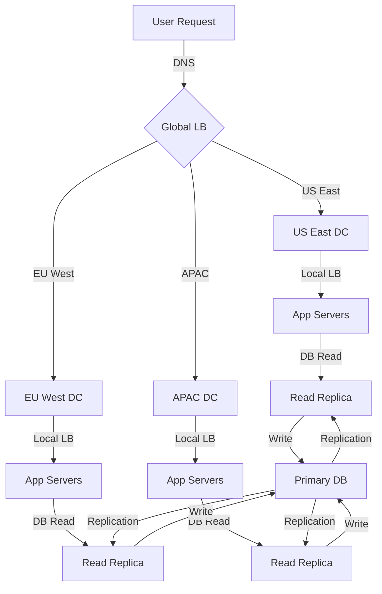

# Data Centers in System Design

> Video Reference: [Data Centers in System Design](https://www.youtube.com/watch?v=6PjFbvaDhKU)

## 1. Asli Problem Kya Hai? (The Core Why)

Socho aap Swiggy ke delivery manager ho. Har roz lakhon orders aate hain, aur log chahte hain ki unka food *exactly* 30‑45 minutes mein pohonch jaye. Agar aapke servers ek hi data center mein hi ho, to ek time zone ke customers ko serve karte hue aapko *latency* aur *availability* ki problem face karni padegi.  

Ek aur example: IRCTC ka booking system. Jab peak season (Christmas, Diwali) mein users booking karte hain, to agar sirf ek data center hota, to *traffic spikes* ke kaaran *denial of service* ho sakta, aur users ko tickets milne mein *hours* lag sakte hain.  

Yeh problem *global reach* aur *high reliability* chahiye, lekin ek single point of failure se *downtime* aur *user frustration* badh jata hai. Data Centers ka idea hi ye hai ki geographically distributed servers se *latency* kam ho, *availability* badhe, aur *fault tolerance* mile.

## 2. Core Architecture & Mechanisms

### 2.1 Geographic Distribution
Data Centers multiple regions (US East, EU West, Asia‑Pacific) mein spread hote hain.  
- **Latency**: User ko nearest DC se response milta hai.  
- **Read Replica**: Main DB se data copy karke read load reduce karte hain.  

### 2.2 Load Balancing & Traffic Routing
- **Global Load Balancer**: DNS‑based routing (e.g., Amazon Route 53) jo user ko nearest DC dikhaata hai.  
- **Local Load Balancer**: L4/L7 balancer (NGINX, Envoy) jo intra‑DC traffic distribute karta hai.  

### 2.3 Data Replication & Consistency
- **Multi‑Region Replication**: Data ko asynchronously ya synchronously replicate kiya jata hai.  
- **Consistency Models**: *Eventual consistency* (Zerodha’s order book) vs *strong consistency* (Banking transactions).  
- **Conflict Resolution**: Vector clocks, CRDTs, or application‑level merges.  

### 2.4 Failure Handling & Disaster Recovery
- **Failover**: Automatic switchover to standby DC when primary fails.  
- **Backup & Restore**: Regular snapshots aur cross‑region backups.  
- **Chaos Engineering**: Randomly shutting down instances to test resilience.  

### 2.5 Security & Compliance
- **Encryption at Rest & Transit**: AES‑256, TLS 1.3.  
- **Regulatory Compliance**: GDPR for EU, PDP for India.  

## 3. Architecture Flow

## 4. Production Case Study

**WhatsApp** uses a *global data center* strategy with multiple regions (US, EU, APAC).  
- Every message is stored in a *primary* DC, then *replicated* to *secondary* DCs using *gossip protocol*.  
- They employ *read replicas* for status checks and *global load balancers* to route users to the nearest DC, reducing latency to < 100 ms.  
- In case of a DC outage, traffic automatically reroutes to the next best DC, ensuring 99.999% uptime.

## 5. Trade-offs (Pros vs Cons)

| Pros | Cons |
|------|------|
| **Low Latency** – users hit nearest DC. | **Complexity** – multi‑region architecture needs careful design. |
| **High Availability** – failover across regions. | **Higher Cost** – multiple data centers, replication bandwidth. |
| **Disaster Recovery** – cross‑region backups. | **Consistency Challenges** – eventual consistency may affect business logic. |
| **Scalability** – add more DCs as traffic grows. | **Data Sovereignty** – regulatory constraints across countries. |
| **Load Distribution** – balanced traffic reduces hotspots. | **Operational Overhead** – monitoring, logging across regions. |

## 6. System Design Interview Cheat Sheet

- **Geographic Spread**: Explain why multiple data centers help with latency and availability.
- **Load Balancing**: Distinguish between global DNS LB and local L4/L7 LB.
- **Replication Models**: Eventual vs strong consistency; mention vector clocks or CRDTs.
- **Failover Mechanisms**: Automatic switchover, backup strategies, and chaos testing.
- **Cost vs Reliability Trade‑off**: Be ready to discuss how to balance budget with SLAs.
