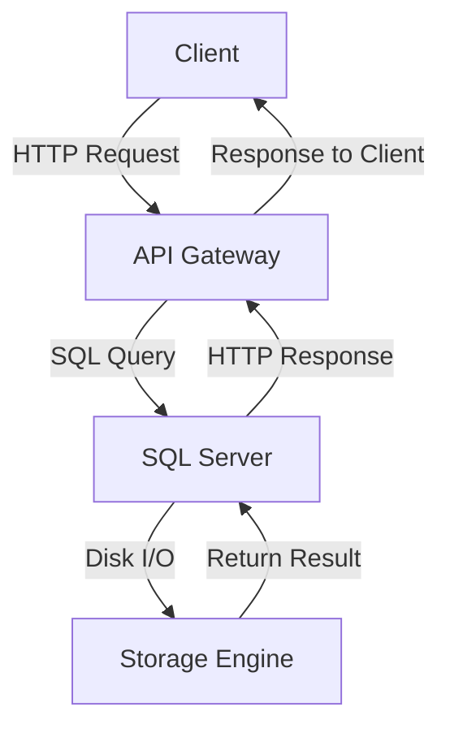

# SQL Tutorial for Beginners

> Video Reference: [SQL Tutorial for Beginners](https://www.youtube.com/watch?v=4TymQ6qQjzc)

## 1. Asli Problem Kya Hai? (The Core Why)

Swiggy ka order placement system socho. Har second hazaar orders aate hain, har order ke saath customer details, restaurant info, payment status, aur delivery status store karna hota hai. Agar ek simple flat file ya in‑memory storage use kiya toh:

- **Latency** badhegi – data fetch karne mein lagne wala time badh jayega, users ko lagta ki app slow hai.
- **Consistency** problem ho sakti hai – ek order update karte waqt dusre users ko purana data dikh sakta hai.
- **Scalability** limited ho jaayegi – ek single server pe load handle nahi ho paayega.

SQL (Structured Query Language) humen structured, ACID compliant databases provide karta hai jisse hum high traffic ke liye reliable aur fast data access kar sakte hain.

## 2. Core Architecture & Mechanisms

### Data Model
- **Tables**: rows (records) aur columns (attributes). Example: `orders(order_id PK, user_id FK, restaurant_id FK, status, amount, created_at)`.
- **Primary Key (PK)**: unique identifier, ensures **Consistency**.
- **Foreign Key (FK)**: relationships, enforces referential integrity.

### CRUD Operations
- **CREATE** – `INSERT INTO orders (…) VALUES (…)`.
- **READ** – `SELECT … FROM orders WHERE …`. Indexing se read latency kam hota hai.
- **UPDATE** – `UPDATE orders SET status = 'delivered' WHERE order_id = …`.
- **DELETE** – `DELETE FROM orders WHERE order_id = …`.

### Query Execution
1. **Parser** – SQL statement ko syntax tree banata hai.
2. **Optimizer** – best execution plan choose karta hai (cost based).
3. **Executor** – plan ko run karke result return karta hai.

### Indexing
- **B‑Tree Index**: most common, quick lookups on equality/ range queries.
- **Covering Index**: index ke andar hi sab columns, read latency reduce.

### Normalization vs Denormalization
- **Normalization**: data redundancy kam, update anomalies avoid.
- **Denormalization**: read heavy scenarios (e.g., Swiggy’s order summary) ke liye joins reduce karne ke liye.

### ACID Properties
- **Atomicity**: transaction ya to poori hoti hai ya hi nahi.
- **Consistency**: database hamesha valid state mein rehta hai.
- **Isolation**: concurrent transactions ek dusre ko disturb nahi karte (Read Committed, Repeatable Read).
- **Durability**: once committed, data survive crash.

## 3. Architecture Flow

## 4. Production Case Study

**Paytm** uses **MySQL** for its transaction ledger. Each transaction (top‑up, recharge, bill payment) is recorded in a `transactions` table. They employ:

- **Read Replicas** for reporting dashboards (low latency reads).
- **Partitioning** by `transaction_date` to keep each shard manageable.
- **Binary Log Replication** for disaster recovery and cross‑region failover.

This setup ensures that while the main replica handles writes (high consistency), read replicas can serve analytics with minimal impact on write latency.

## 5. Trade-offs (Pros vs Cons)

| Pros | Cons |
|------|------|
| **Strong consistency & ACID** – reliable data for finance, e‑commerce. | **Write latency** can increase due to transaction logs. |
| **Rich querying** – joins, aggregates, window functions. | **Scaling writes** requires sharding or replicas, adding complexity. |
| **Mature tooling** – ORMs, migrations, monitoring. | **Schema changes** can be painful in production (downtime risk). |
| **Community support** – extensive documentation, forums. | **Cost** – licensing for commercial DBMS (Oracle, SQL Server). |

## 6. System Design Interview Cheat Sheet

- **Explain ACID vs BASE**: why SQL prefers ACID for transactions.
- **Indexing strategy**: B‑Tree vs Hash, covering indexes, when to drop indexes.
- **Normalization levels**: 1NF to 3NF, trade‑offs with denormalization.
- **Read/Write scaling**: replication, sharding, partitioning.
- **Backup & recovery**: point‑in‑time recovery, binary logs, cold backups.
