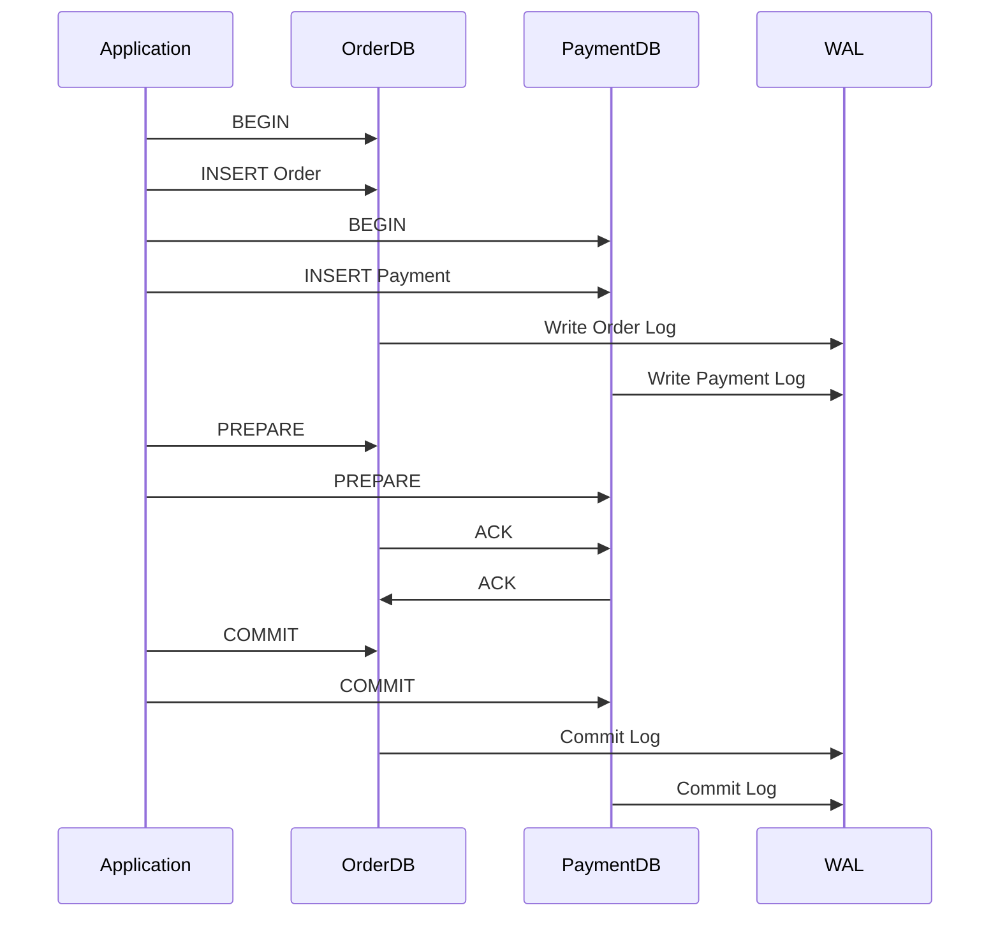

# SQL Transactions and ACID Properties

> Video Reference: [SQL Transactions and ACID Properties](https://www.youtube.com/watch?v=LoxO-P7hhUQ)

## 1. Asli Problem Kya Hai? (The Core Why)

Imagine **Swiggy** trying to place an order.  
- Customer places ₹250 food order.  
- Kitchen confirms the order.  
- Payment gateway authorises ₹250.  
- Inventory system deducts the ingredients.  
- Delivery rider gets assigned.

If koi bhi step fail ho jaata (e.g., payment gateway down, inventory out of stock), humko ya to **partial data** chahiye (order placed but payment not captured) ya **inconsistent state** (payment taken but order not created). Ye situation **data inconsistency** aur **user frustration** ka major cause ban sakti hai.  

**Why we need ACID?**  
- **Atomicity**: Order placement either fully succeeds or fully fails.  
- **Consistency**: Database stays in valid state (e.g., no negative inventory).  
- **Isolation**: Concurrent orders don’t step on each other’s toes.  
- **Durability**: Once confirmed, data survives crashes.  

Without ACID, Swiggy could end up double charging users, delivering wrong food, or losing inventory data – a nightmare for both customers and the business.

## 2. Core Architecture & Mechanisms

### Transaction Lifecycle

1. **BEGIN** – Application tells DB to start a transaction.  
2. **Read/Write** – All queries run within this boundary.  
3. **COMMIT** – DB writes all changes to disk and releases locks.  
4. **ROLLBACK** – In case of error, DB undoes all changes.

### ACID Properties Explained

| Property | What It Means (Hinglish) | Example in Swiggy |
|----------|--------------------------|-------------------|
| **Atomicity** | Ek transaction ke sab steps ek hi bar complete honge, otherwise sab undo. | Agar payment fail ho, whole order rollback. |
| **Consistency** | DB ka schema constraints (e.g., foreign keys) hamesha true rahe. | No negative inventory count. |
| **Isolation** | Parallel orders ke changes ek doosre ko disturb nahi karte. | Two riders picking same order simultaneously. |
| **Durability** | Once COMMIT, data survive crash. | Order data stored in WAL before crash. |

### Locking & Isolation Levels

- **Read Committed** – Avoids dirty reads, but can have non-repeatable reads.  
- **Repeatable Read** – Prevents non-repeatable reads, but can lead to phantom reads.  
- **Serializable** – Full isolation, but lowest throughput.

In production, Swiggy often uses **Repeatable Read** (InnoDB default) to balance consistency with latency.

### Write-Ahead Logging (WAL)

Before any data page is changed, a log record is written to disk. If crash happens, DB replays WAL to recover. This gives **Durability**.

### Two-Phase Commit (2PC)

When a transaction spans multiple databases (e.g., payment gateway DB + order DB), 2PC ensures all participants commit or all rollback.  
- **Prepare Phase** – DBs lock rows & write “prepared” log.  
- **Commit Phase** – If all prepared, send COMMIT; else ROLLBACK.

## 3. Architecture Flow

## 4. Production Case Study

**Zerodha** handles millions of trades per second.  
- They use **PostgreSQL** with **InnoDB** for order books.  
- Each trade execution is a single transaction:  
  1. Validate user balance.  
  2. Update order book.  
  3. Deduct balance.  
  4. Record trade history.  
- If any step fails, a **ROLLBACK** ensures no partial execution.  
- They employ **Read Committed** isolation to keep latency low while still preventing dirty reads.  
- For cross-service consistency (e.g., updating both trade history and margin engine), Zerodha uses **2PC** over a lightweight transaction manager.

Result: Zero “ghost trades” and instant consistency across services, even under peak loads.

## 5. Trade-offs (Pros vs Cons)

| Pros | Cons |
|------|------|
| Guarantees data correctness (no partial updates). | Higher latency due to locking & logging. |
| Simplifies application logic (no manual rollback). | Reduced throughput, especially with Serializable isolation. |
| Works well with single-node relational DBs. | Complex to scale horizontally; not ideal for NoSQL or sharded setups. |
| Durability ensures data survives crashes. | Requires careful tuning of WAL and checkpoint intervals. |
| Strong consistency across services with 2PC. | 2PC adds network overhead and can lead to deadlocks. |

## 6. System Design Interview Cheat Sheet

- **Define the scope**: single DB transaction vs distributed transaction.  
- **List ACID properties** and explain why each matters.  
- **Choose isolation level** based on consistency vs latency trade‑off.  
- **Explain rollback path**: WAL + undo logs.  
- **Mention scalability limits**: horizontal sharding vs single-node ACID.  

Use these points to quickly demonstrate mastery over SQL transactions in any interview scenario.
