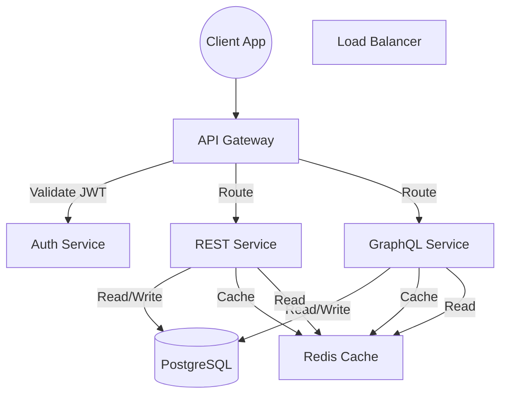

# How to Design APIs Like a Senior Engineer (REST, GraphQL, Auth, Security)

> Video Reference: [How to Design APIs Like a Senior Engineer (REST, GraphQL, Auth, Security)](https://www.youtube.com/watch?v=Rrd6xkyjPB8)

## 1. Asli Problem Kya Hai? (The Core Why)

Maan lo Swiggy ke ek delivery driver ko 10,000 orders ek din mein handle karne hain.  
Har order ke liye ek API call ki jarurat hoti – create order, update status, cancel, etc.  
Agar hum simple CRUD REST endpoints bana lete hain, toh:

- **Latency** barh jati hai – har request mein authentication, validation, DB hit, aur response time.
- **Throughput** kam ho jata hai – 10k calls ka load ek hi endpoint pe choke ho sakta hai.
- **Data consistency** problem ho sakti hai – multiple microservices ko same order data update karna padta hai, conflict ho sakta hai.
- **Security** gaps – har endpoint pe alag validation, rate limiting, and token checks lagana mushkil hota hai.

Agar hum isko solve na kare, customers ko lagta hai app slow hai, orders miss hote hain, aur hackers ko vulnerable endpoints mil jate hain. Isliye ek solid API design zaroori hai.

## 2. Core Architecture & Mechanisms

### 2.1 API Style: REST vs GraphQL
- **REST** – traditional, resource‑oriented. Har operation ek URL + HTTP verb. Simple, caching ka support, but over‑fetching/under‑fetching ho sakta hai.
- **GraphQL** – single endpoint, client ko exactly data milta hai. Bloat kam hota, but query complexity aur caching thoda tricky.

**Decision**: High‑traffic services (Swiggy, Paytm) use REST for simple CRUD and GraphQL for complex queries (e.g., order history with nested items).

### 2.2 Authentication & Authorization
- **JWT** – stateless, scalable. Server issue kare token, client store kare local storage. Refresh token flow zaroori.
- **OAuth2** – third‑party logins (Google, Facebook) ke liye. Authorization code grant flow se security badhti hai.
- **API Key** – internal microservices ke beech communication ke liye.

**Implementation**: Use an **Auth Service** that issues JWTs and handles password hashing (bcrypt). All API Gateways validate token before forwarding.

### 2.3 Security Measures
- **Rate Limiting** – per‑IP & per‑user limit (e.g., 1000 req/min) to prevent DoS.
- **Input Validation** – schema validation (JSON Schema, Joi) to avoid injection attacks.
- **Encryption** – TLS everywhere. Sensitive fields (PPI) encrypted in DB (AES‑256).
- **CORS & CSP** – restrict origins, use strict content‑security‑policy.
- **Monitoring & Logging** – centralized logs (ELK) + alerts on suspicious patterns.

### 2.4 Scalability & Resilience
- **Load Balancer** – round‑robin or least‑conn for API Gateways.
- **Read Replicas** – for read‑heavy endpoints (order history). Write sharding (partition by user_id) to reduce contention.
- **Circuit Breaker** – Hystrix style to avoid cascading failures.
- **Cache** – Redis for session tokens, frequently accessed data (restaurant menus).

## 3. Architecture Flow

## 4. Production Case Study

**Uber** – Their driver‑app uses a hybrid approach.  
- **REST** for basic endpoints: `/drivers/{id}`, `/rides`, etc.  
- **GraphQL** for complex queries like `driverAvailability` that fetches multiple tables (vehicle, location, ratings) in one shot.  
- **Auth** – each request carries a JWT issued by Uber’s auth service.  
- **Security** – rate limiting at gateway level, field‑level encryption for PPI, and continuous vulnerability scanning.  
- **Scalability** – 50k concurrent connections handled by a combination of Nginx load balancer, Kubernetes pods, and read replicas.

Result: 99.9% uptime, low latency (under 200 ms avg), and secure data handling.

## 5. Trade-offs (Pros vs Cons)

| Pros | Cons |
|------|------|
| **REST** – Easy to understand, built‑in caching, wide ecosystem | **REST** – Over‑fetch/under‑fetch, versioning headaches |
| **GraphQL** – Single endpoint, precise data, reduces round trips | **GraphQL** – Complex query planning, harder caching, learning curve |
| **JWT** – Stateless, scales horizontally | **JWT** – Token revocation difficult, large payload |
| **OAuth2** – Third‑party auth, delegation | **OAuth2** – Requires redirect flow, more moving parts |
| **API Gateway** – Centralized auth, rate limiting | **Gateway** – Single point of failure if not redundant |
| **Read Replicas** – Faster reads, load distribution | **Read Replicas** – Replication lag, eventual consistency |
| **Circuit Breaker** – Prevent cascading failures | **Circuit Breaker** – Adds latency if open state |

## 6. System Design Interview Cheat Sheet

- **Scope & Constraints** – define traffic, latency, data model, security needs.
- **Choose API Style** – REST for CRUD, GraphQL for nested queries; justify choice.
- **Auth & Security** – JWT/OAuth2, rate limiting, encryption, monitoring.
- **Scalability** – Load balancer, sharding, read replicas, caching strategy.
- **Trade‑offs** – Discuss pros/cons of each decision, show awareness of real‑world constraints.
