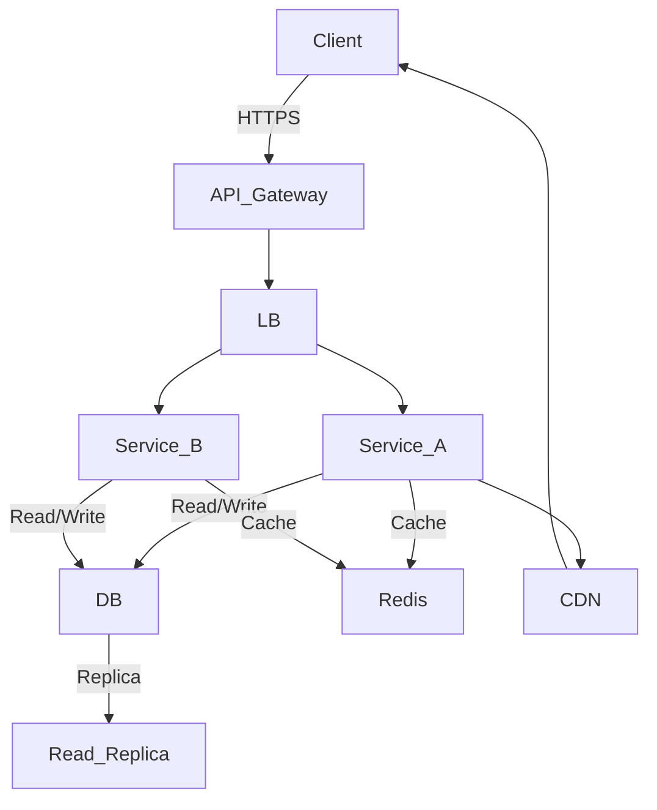

# System Design Explained: APIs, Databases, Caching, CDNs, Load Balancing & Production Infra

> Video Reference: [System Design Explained: APIs, Databases, Caching, CDNs, Load Balancing & Production Infra](https://www.youtube.com/watch?v=oYxTTirKY8M)

## 1. Asli Problem Kya Hai? (The Core Why)

Socho ki Swiggy ka order system hai. Din mein 50 lakh orders aa sakte hain, har ek order ko 2‑3 second ke andar confirm karna hota hai. Agar APIs slow ho, database locks ho, ya CDN miss kare, toh customers ka order fail ho jayega – aur user trust kho jayega. Isi liye high‑traffic Indian products ko ek scalable, low‑latency architecture chahiye jo **latency**, **throughput**, aur **availability** ko balance kare.

## 2. Core Architecture & Mechanisms

### 2.1 APIs & Load Balancers  
APIs ko front‑end se alag layer (API Gateway) mein rakhte hain. Load Balancer (LB) traffic ko multiple instances pe distribute karta hai, jisse **throughput** badhta hai aur **single point of failure** kam hota hai.

### 2.2 Databases – SQL vs NoSQL  
- **SQL**: ACID compliance, strong consistency, ideal for transactional data (e.g., order details).  
- **NoSQL**: eventual consistency, high write throughput, useful for session data, caching, analytics.

### 2.3 Caching  
- **In‑memory cache** (Redis, Memcached) reduces DB hits, lowers **latency**.  
- **Read replicas**: read traffic ko offload karte hain, read latency aur scalability improve hoti hai.

### 2.4 CDNs  
Content Delivery Networks edge servers pe static assets (images, JS) store karte hain. Latency reduce hoti hai aur **global reach** achieve hota hai.

### 2.5 Production Infra  
- **Microservices**: each service independent scaling.  
- **Service discovery & Gossip protocol**: services automatically apne state share karte hain, fault tolerance badhata hai.  
- **Health checks** & **auto‑scaling**: system ko dynamically adapt karne ke liye.

## 3. Architecture Flow

## 4. Production Case Study

**Zerodha**:  
Zerodha ne apni trading platform ke liye **Redis** as a cache layer use kiya, jisse order book updates milliseconds mein client ko mile. They also use **Kafka** for event streaming between services, ensuring low latency. For global clients, they deploy **CDN** (Akamai) for static assets. Load balancers (NGINX) distribute traffic across multiple geo‑regions, while **read replicas** handle heavy read traffic during market hours.

## 5. Trade-offs (Pros vs Cons)

| Pros | Cons |
|------|------|
| *High throughput* with load balancers & microservices | *Increased operational complexity* |
| *Low latency* using caching & CDNs | *Cache invalidation challenges* |
| *Scalability* via read replicas & auto‑scaling | *Higher infrastructure cost* |
| *Fault tolerance* with service discovery & gossip | *Potential consistency issues (eventual)* |
| *Global reach* through CDNs | *Latency spikes during edge failures* |

## 6. System Design Interview Cheat Sheet

- **Start with requirements**: traffic, latency, consistency.
- **Sketch high‑level flow**: client → API → LB → services → DB/CDN.
- **Choose storage**: SQL for transactions, NoSQL for high‑write.
- **Add caching**: Redis/Memcached + read replicas.
- **Plan scaling**: autoscale, sharding, geo‑distribution.
