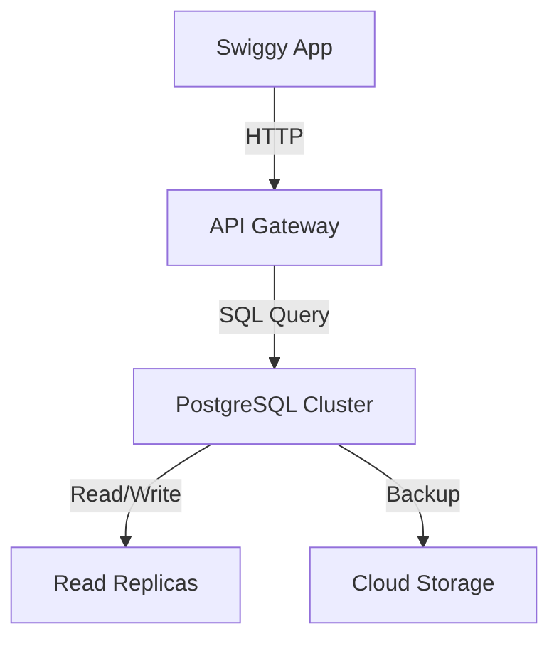
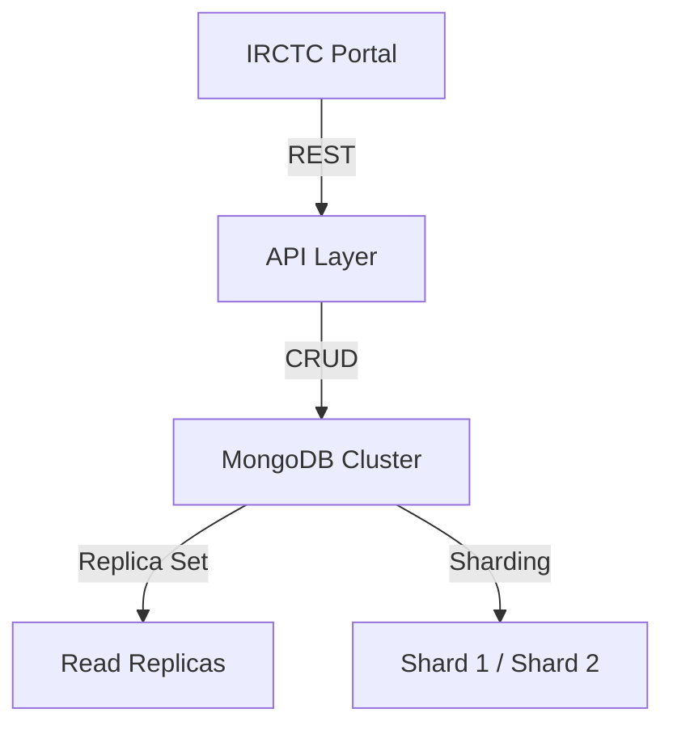
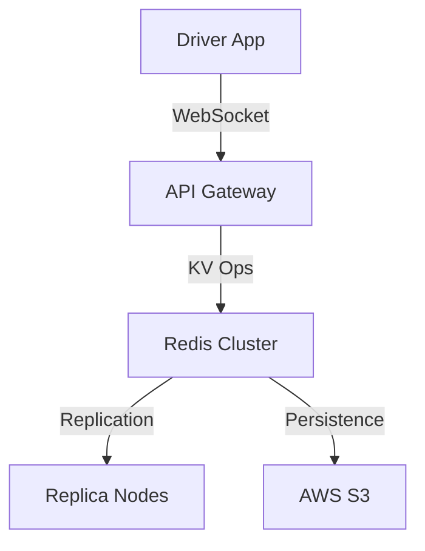
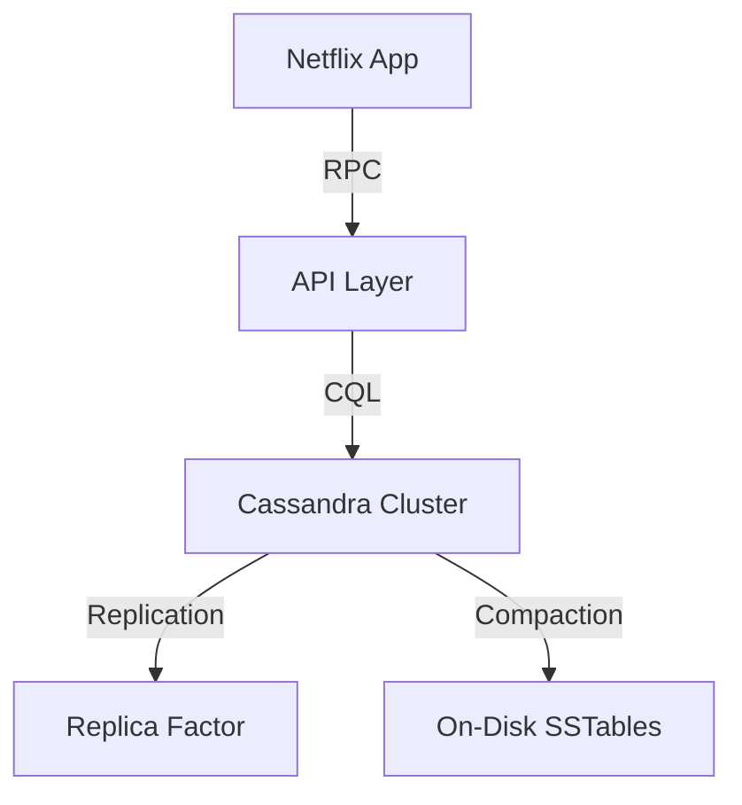
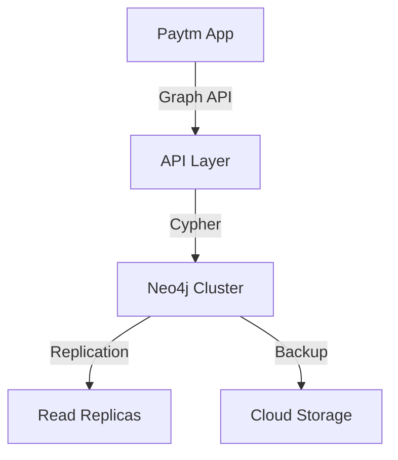
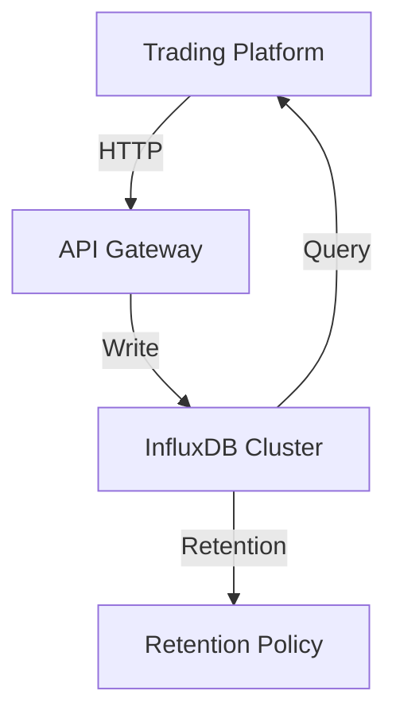
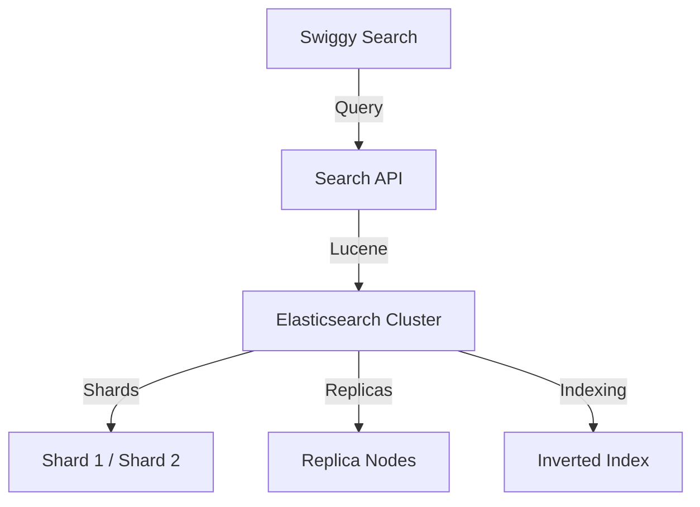

# 7 Database Types Every Software Engineer Should Know

> Video Reference: [7 Database Types Every Software Engineer Should Know](https://www.youtube.com/watch?v=5coDJ2b4Xuo)

## Relational Database (SQL)

### 1. Asli Problem Kya Hai? (The Core Why)

Swiggy ka order‑tracking system socho. Har order ka status, customer details, payment info, aur restaurant data ek saath store karna hota. Agar hum ek simple file system ya key‑value store use karein, to joins, transactions aur data consistency mushkil ho jayegi. SQL databases is problem ko solve karte hain by enforcing ACID properties, relational schemas, aur powerful query language jisse data integrity aur complex relationships handle ho sakte hain.

### 2. Core Architecture & Mechanisms

- **Schema**: Tables with columns, primary/foreign keys.  
- **ACID**: Atomicity, Consistency, Isolation, Durability – ensures reliable transactions.  
- **Indexing**: B‑tree, hash indexes for fast lookups.  
- **Query Optimizer**: Plans best execution strategy.  
- **Replication & Sharding**: High availability & scalability.

### 3. Architecture Flow

### 4. Production Case Study

**Zomato** uses MySQL for order metadata and user profiles. They employ read replicas for analytics and write scaling. To handle peak traffic (like during festivals), they shard certain tables (e.g., orders) by region, ensuring queries stay fast.

### 5. Trade-offs (Pros vs Cons)

| Pros | Cons |
|------|------|
| Strong consistency, ACID guarantees | Limited horizontal scalability |
| Mature tooling & ecosystem | Schema migrations can be painful |
| Powerful joins & aggregations | Complex queries can be slow on huge data |
| Good for structured data | Requires careful indexing |

### 6. System Design Interview Cheat Sheet

- Explain ACID vs BASE.
- Discuss sharding strategies (range, hash, directory).
- Talk about replication lag & read‑write split.
- Mention indexing trade‑offs (B‑tree vs hash).
- Be ready to sketch a basic ER diagram.

---

## Document Store (NoSQL)

### 1. Asli Problem Kya Hai? (The Core Why)

IRCTC ka booking system socho. Har ticket ka data (train id, seat numbers, passenger details) ek document ke roop mein store karna convenient hai, kyunki data schema flexible hai aur read/write latency kam hoti hai. Relational DBs mein ek ticket ke liye alag tables aur joins lag jayenge, jo slow ho sakte hain.

### 2. Core Architecture & Mechanisms

- **Document Model**: JSON/BSON objects.  
- **Schema‑less**: Different documents in same collection can have different fields.  
- **CAP**: Often tuned for Consistency & Partition tolerance (CP).  
- **Indexing**: Field‑based indexes, text indexes.  
- **Replication**: Automatic, with eventual consistency.

### 3. Architecture Flow

### 4. Production Case Study

**Paytm** stores user session data and payment metadata in Couchbase. Each transaction is a document, allowing fast reads during checkout and flexible schema changes during feature rollouts.

### 5. Trade-offs (Pros vs Cons)

| Pros | Cons |
|------|------|
| Flexible schema, rapid iteration | Eventual consistency can be tricky |
| Easy horizontal scaling (sharding) | Lack of joins, complex queries hard |
| Good for high write workloads | Data duplication leads to consistency challenges |
| Native JSON support | Strong consistency requires extra effort |

### 6. System Design Interview Cheat Sheet

- Explain how to design a sharded document store.
- Discuss consistency models (eventual vs strong).
- Talk about indexing strategies for queries.
- Mention replication and failover handling.
- Be ready to justify schema design choices.

---

## Key‑Value Store

### 1. Asli Problem Kya Hai? (The Core Why)

Ola’s real‑time driver‑passenger matching requires storing session tokens, ride states, and geolocation snapshots. Each entry is a simple key‑value pair, so a key‑value store gives ultra‑low latency and easy scaling.

### 2. Core Architecture & Mechanisms

- **Simple API**: `GET`, `SET`, `DELETE`.  
- **In‑Memory or Disk**: Redis (RAM), DynamoDB (SSD).  
- **Replication**: Master‑slave or multi‑region.  
- **Persistence**: Snapshotting or append‑only logs.  
- **Scalability**: Consistent hashing for sharding.

### 3. Architecture Flow

### 4. Production Case Study

**Uber** uses Redis for real‑time surge pricing data. The price matrix is cached in Redis so that every request fetches the latest rate in microseconds, ensuring no lag for riders.

### 5. Trade-offs (Pros vs Cons)

| Pros | Cons |
|------|------|
| Extremely low latency | Limited query capabilities |
| Simple to scale horizontally | Data loss risk without persistence |
| Good for caching | No relational integrity |
| Easy to implement | Requires external consistency handling |

### 6. System Design Interview Cheat Sheet

- Explain data eviction policies (LRU, LFU).
- Discuss sharding via consistent hashing.
- Talk about persistence vs durability trade‑offs.
- Mention use of Pub/Sub for event propagation.
- Be ready to sketch cache invalidation strategies.

---

## Column‑Family Store

### 1. Asli Problem Kya Hai? (The Core Why)

Netflix’s viewing history: for each user, we need to store millions of logs (watch time, timestamps, device). A column‑family DB lets us store sparse rows efficiently, as each user may have a different set of attributes.

### 2. Core Architecture & Mechanisms

- **Row Key & Column Family**: Partition key + clustering columns.  
- **Wide Rows**: Many columns per row, stored on disk as SSTables.  
- **Consistency**: Tunable (strong to eventual).  
- **Compaction**: Merges SSTables to reduce read amplification.  
- **Replication**: Ring‑based, configurable RF.

### 3. Architecture Flow

### 4. Production Case Study

**Zerodha** stores tick data and order book snapshots in Apache Cassandra. Each tick is a column, allowing quick range queries over time without scanning whole tables, which is vital for high‑frequency trading analytics.

### 5. Trade-offs (Pros vs Cons)

| Pros | Cons |
|------|------|
| High write throughput | Reads can be slower for small row scans |
| Tunable consistency | Complex data modeling |
| Linear scalability | Requires careful compaction tuning |
| Built‑in replication | Limited secondary indexes |

### 6. System Design Interview Cheat Sheet

- Explain partition key vs clustering key.
- Discuss consistency levels (QUORUM, ALL).
- Talk about write path (memtable, commit log).
- Mention read repair and hinted handoff.
- Be ready to design a schema for time‑series data.

---

## Graph Database

### 1. Asli Problem Kya Hai? (The Core Why)

Paytm’s recommendation engine: we need to find friends of friends, transaction patterns, and fraud detection. Graph DBs model entities and relationships directly, making traversal queries efficient.

### 2. Core Architecture & Mechanisms

- **Nodes & Edges**: Vertices and relationships.  
- **Labels & Properties**: Flexible schema.  
- **Traversal Algorithms**: BFS, DFS, shortest path.  
- **Consistency**: Usually strong, ACID per transaction.  
- **Partitioning**: Graph‑aware sharding (e.g., using embedding).

### 3. Architecture Flow

### 4. Production Case Study

**WhatsApp** uses a graph‑like structure in Erlang/riak to manage contacts and group chats. Each user is a node; relationships represent friendships or group memberships, enabling quick lookup of mutual contacts.

### 5. Trade-offs (Pros vs Cons)

| Pros | Cons |
|------|------|
| Natural modeling of relationships | Scaling large graphs is hard |
| Efficient traversal queries | Limited ad‑hoc analytical queries |
| Good for recommendation & fraud detection | Data duplication can occur |
| Strong consistency per transaction | Requires specialized expertise |

### 6. System Design Interview Cheat Sheet

- Differentiate between property graph and RDF.
- Explain index creation (node, relationship).
- Discuss sharding strategies for large graphs.
- Talk about transaction isolation levels.
- Be ready to sketch a friend‑of‑a‑friend query.

---

## Time Series Database

### 1. Asli Problem Kya Hai? (The Core Why)

Zerodha’s tick data: millions of price points per second. Traditional RDBMS would choke on inserts and slow down aggregations. A TSDB stores data in time‑ordered blocks, optimized for ingestion and down‑sampling.

### 2. Core Architecture & Mechanisms

- **Series ID + Timestamp**: Primary key.  
- **Chunked Storage**: Fixed‑size time windows.  
- **Retention Policies**: Auto‑deletion or down‑sampling.  
- **Compression**: Gorilla, LZ4.  
- **Query Language**: SQL‑like (InfluxQL, PromQL).

### 3. Architecture Flow

### 4. Production Case Study

**Netflix** uses Prometheus to collect metrics like request latency and CPU usage. Data is stored in time‑ordered series, enabling rapid alerting and dashboards with Grafana.

### 5. Trade-offs (Pros vs Cons)

| Pros | Cons |
|------|------|
| Fast ingestion & query on time ranges | Limited support for complex joins |
| Built‑in down‑sampling & retention | Data duplication for multiple tags |
| Efficient compression | Not ideal for unstructured data |
| Good for monitoring & analytics | Requires careful schema design |

### 6. System Design Interview Cheat Sheet

- Explain retention policies and down‑sampling.
- Discuss shard key and data distribution.
- Talk about query optimization (indexing on tags).
- Mention integration with alerting systems.
- Be ready to design ingestion pipeline for high‑frequency data.

---

## Search Engine (Full‑Text Search)

### 1. Asli Problem Kya Hai? (The Core Why)

Swiggy’s menu search: users type “pasta” and want instant results across thousands of restaurants. A search engine indexes text and provides fuzzy, ranked results far faster than a relational DB scan.

### 2. Core Architecture & Mechanisms

- **Inverted Index**: Term → list of documents.  
- **Scoring**: TF‑IDF, BM25.  
- **Sharding**: By document id or field.  
- **Near‑Real Time (NRT)**: Commit and refresh cycles.  
- **Distributed**: Master/Shard/Replica architecture.

### 3. Architecture Flow

### 4. Production Case Study

**Zomato** uses Elasticsearch to power restaurant search and review aggregation. They index menu items, ratings, and location data, enabling faceted search and real‑time suggestions.

### 5. Trade-offs (Pros vs Cons)

| Pros | Cons |
|------|------|
| Fast full‑text search & ranking | Requires separate infrastructure |
| Near‑real‑time indexing | Consistency lag between source DB and index |
| Scalable via sharding | Complex query tuning |
| Built‑in analytics (aggregation) | High memory footprint for indices |

### 6. System Design Interview Cheat Sheet

- Explain inverted index and tokenization.
- Talk about shard allocation and replica strategy.
- Discuss refresh interval & commit policies.
- Mention query DSL features (bool, match, fuzzy).
- Be ready to justify indexing strategy for a large product catalog.

---
