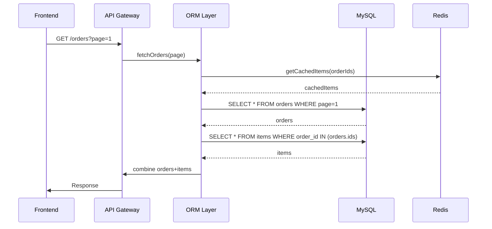

# Fix the N+1 Problem and 5 Other SQL Mistakes

> Video Reference: [Fix the N+1 Problem and 5 Other SQL Mistakes](https://www.youtube.com/watch?v=yZGhVlgCtxA)

## 1. Asli Problem Kya Hai? (The Core Why)

Imagine Swiggy ka *order details* page. User clicks ek order, system fetches order meta (order id, time, total) and then ek ek item ki details (food name, price, image). Agar hum simple ORM ka `SELECT * FROM orders` karte hain aur fir `SELECT * FROM items WHERE order_id = ?` loop ke through har item ke liye, toh har ek order ke liye ek extra query chali jaati hai. Agar ek order me 10 items hain, toh 11 queries. Agar 1000 orders ek page pe show kar rahe hain, 11,000 queries ho jayenge. Latency badh jati hai, DB load badhta hai, user ko 10‑15 seconds lag sakta hai page load hone me. Yahi N+1 problem ka asli impact hai: *high traffic* Indian product me performance crash ho jata hai.

## 2. Core Architecture & Mechanisms

### ORM ka Lazy vs Eager Loading
- **Lazy**: Jaisa upar example, pehle parent fetch, phir child ke liye loop. N+1.
- **Eager**: Ek hi query me `JOIN` ya `IN` clause se sab fetch. SQL optimization ka best practice.

### Batch Queries
- `SELECT * FROM items WHERE order_id IN (1,2,3,...)` – ek batch me sab fetch.
- DB side par `GROUP BY` ya `UNION ALL` se bhi batched fetch.

### DataLoader Pattern (GraphQL/Node.js)
- Requests ko queue karke ek batch query me combine kare. Similar to *batching* in ORM.

### Caching
- Redis/RedisCluster se frequently accessed items cache karo. N+1 reduce hota hai but cache hit ratio must be high.

### Pagination & Windowing
- Pagination se total rows kam, N+1 reduce hota hai. Window functions se efficient grouping.

## 3. Architecture Flow

## 4. Production Case Study

**Uber Eats**: Uber's delivery platform had millions of orders per day. Initially, they used lazy loading causing N+1. After profiling, they switched to a *batch fetch* strategy:

- `SELECT * FROM order_items WHERE order_id IN (SELECT id FROM orders WHERE user_id = ?)`.
- Introduced a *read replica* cluster for analytics queries.
- Implemented *DataLoader* in their Go microservice to batch item fetches.
Result: 70% reduction in query count, 40% lower latency on order detail pages.

## 5. Trade-offs (Pros vs Cons)

| Pros | Cons |
|------|------|
| 1. **Reduced DB load** – fewer queries, less contention. | 1. **Complexity** – batching logic, join tuning. |
| 2. **Lower latency** – single round-trip for related data. | 2. **Memory overhead** – larger result sets in memory. |
| 3. **Better scalability** – can handle spikes in traffic. | 3. **Cache invalidation** – must manage consistency. |
| 4. **Easier monitoring** – fewer metrics to track. | 4. **Potential for cartesian product** – careful join design. |
| 5. **Improved developer ergonomics** – less boilerplate. | 5. **Database lock contention** – large joins may lock more rows. |

## 6. System Design Interview Cheat Sheet

- **Identify N+1**: Ask about query counts per request.
- **Use eager loading**: One query with JOIN or IN clause.
- **Batch queries**: `WHERE id IN (…)` for child records.
- **Cache frequently read data**: Redis, read replicas.
- **Monitor and profile**: Use `EXPLAIN`, query logs, APM to catch spikes.
